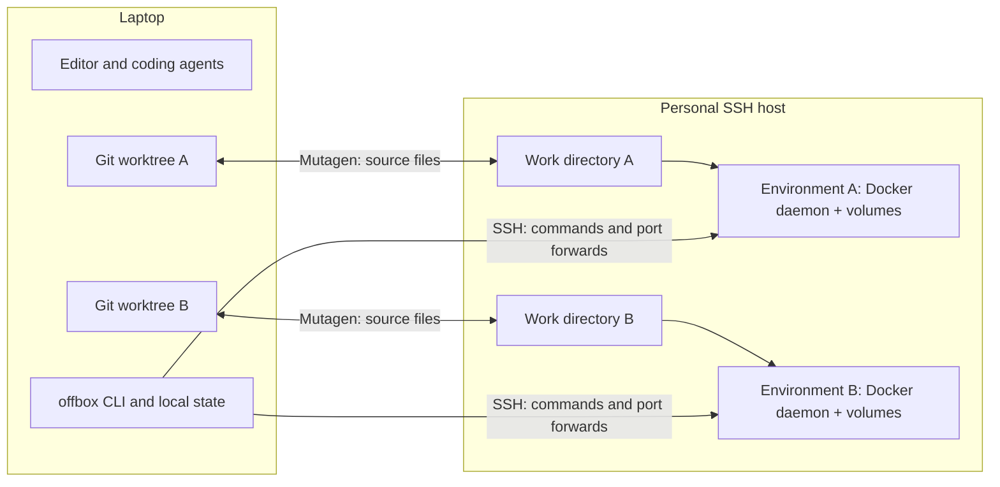

# offbox

[](https://github.com/o-avdieiev/offbox/actions/workflows/test.yaml)
[](https://github.com/o-avdieiev/offbox/blob/master/LICENSE)
[](https://github.com/o-avdieiev/offbox/blob/master/pyproject.toml)

Give every git worktree its own Docker stack on one cloud VM you own. Your compose files don't change.

Running several coding agents or worktrees in parallel means several full Docker Compose stacks: databases, browsers, builds and test runs competing for one laptop's CPU, memory and ports. Offbox moves those stacks to a single VM and gives each worktree its own Docker daemon, volumes and port forwards. Your editor, agents and Git stay on the laptop.

On a Google Cloud `e2-standard-4` VM, a warm `offbox exec -- true` took a median **1.07 s** end to end, including the sync flush and dependency checks; a first `up` of the FastAPI/Postgres sample took **39 s**, and the VM cost about **$0.15/hour**. See the [Google Cloud](https://github.com/o-avdieiev/offbox/blob/master/docs/benchmarks/2026-10-23-gcp.md) and [Hetzner](https://github.com/o-avdieiev/offbox/blob/master/docs/benchmarks/2026-10-23-hetzner.md) benchmark reports for method and limits.

## Quickstart

Use macOS, Linux, or [Windows through WSL2](https://github.com/o-avdieiev/offbox/blob/master/docs/installation.md#windows-wsl2). You need Git and OpenSSH on your laptop, plus a cloud account or an existing Ubuntu server. **Docker does not need to be installed on your laptop.**

**1. Choose a host provider.** Follow the short credential steps for [Hetzner](https://github.com/o-avdieiev/offbox/blob/master/docs/installation.md#hetzner), [Google Cloud](https://github.com/o-avdieiev/offbox/blob/master/docs/installation.md#google-cloud), or an [existing server](https://github.com/o-avdieiev/offbox/blob/master/docs/installation.md#existing-ubuntu-server). Offbox never asks you to paste a cloud token into a prompt.

**2. Install and run guided setup:**

```sh
curl -LsSf https://raw.githubusercontent.com/o-avdieiev/offbox/master/install.sh | OFFBOX_SOURCE=offbox sh
```

This installs the published PyPI release, installs uv if needed, and opens `offbox setup` on a terminal. Setup checks prerequisites, offers verified Mutagen and an SSH key when missing, and can create a **billable** VM after your approval. OpenTofu is downloaded when needed. If prompted to open a new terminal, do so before continuing; if setup did not run or finish, run `offbox setup`. Already have uv? Use `uv tool install offbox`, then `offbox setup`. See the [installation guide](https://github.com/o-avdieiev/offbox/blob/master/docs/installation.md) for PATH help and each platform's steps.

**3. Start an environment at your Git worktree root:**

```sh
cd your-repo
offbox up
offbox exec -- uname -s    # Linux: this command ran on the VM
offbox ports
```

Your files sync automatically. Offbox starts a root Compose stack when present, but does not guess how to install your project's dependencies. Add an optional `offbox.toml` for install and stack commands; see [your first project](https://github.com/o-avdieiev/offbox/blob/master/docs/installation.md#your-first-project) or the working examples below. Use `offbox exec -- YOUR_COMMAND` for tests and builds; your editor, agents and Git stay local.

**4. Clean up when finished:**

```sh
offbox rm --yes                 # remove this worktree's environment and Docker data
offbox host list
offbox host destroy main --yes  # use the actual host name from the list
```

Hosts created by guided setup are manual: removing an environment does not delete that host. `offbox stop` keeps environment data and does not stop VM billing. For optional create-on-demand and cleanup, see [auto-managed hosts](https://github.com/o-avdieiev/offbox/blob/master/docs/configuration.md#auto-managed-hosts); idle cleanup requires the laptop's reaper timer. Hetzner bills stopped servers too: [billing rules](https://docs.hetzner.com/cloud/billing/faq/).

## How it works



Both worktrees can publish remote port 8000 and use the same Compose container names. Offbox gives them separate Docker daemons and local forwards such as `localhost:8000` and `localhost:8001`. `offbox ports --swap 8000` exchanges the preferred local port when an app needs a fixed callback URL.

`up` creates or starts the environment, synchronizes files, installs declared dependencies, starts the declared stack and restores forwards. `exec` flushes sync, checks dependency hashes and streams the requested command with its actual exit code. Your laptop’s `.git` is excluded from sync. Offbox creates a separate Git repository in the environment by default so Git-aware tools work there; keep commits, branches and pushes on the laptop. See [Git mirroring](https://github.com/o-avdieiev/offbox/blob/master/docs/configuration.md#git-mirror).

Use `offbox --timings up` or `offbox --timings exec -- COMMAND` to see stage durations on stderr. Timing totals exclude Python/CLI startup; command output and exit codes are preserved.

## Why not DevPod, Codespaces or Docker over SSH?

- **Worktree-native.** Each worktree gets its own Docker daemon, volumes and port forwards on the shared VM, so several worktrees can run the same Compose project, with the same container names and ports, at the same time.
- **Nothing to adopt.** No `devcontainer.json`, no changes to your compose files and no offbox daemon or control plane to run. An optional `offbox.toml` declares install and stack commands when the defaults are not enough.
- **Your editor, agents and Git stay local.** Mutagen keeps files in sync both ways; commands and port forwards go over SSH.
- **One VM you own.** Hetzner, Google Cloud or any Ubuntu 24.04 server you can reach over SSH. You pay the provider directly.

Use DevPod or Codespaces if you want a full remote editor environment defined by `devcontainer.json`. Use sandbox APIs such as [E2B](https://e2b.dev/docs) for untrusted code.

## Requirements and scope

- macOS or Linux client, Python 3.12+, Git 2.30+, OpenSSH 8+ and Mutagen 0.18.x; `offbox setup` downloads a verified Mutagen 0.18.1 if none is installed. Windows clients use WSL2.
- An Ubuntu 24.04 amd64 host. The universal image is Linux amd64; an Apple Silicon laptop is supported as a client.
- OpenTofu 1.8+ or Terraform 1.6+ for cloud provisioning. If neither is installed, Offbox can download verified pinned OpenTofu.
- Trusted personal projects. Environment containers are privileged and share the host kernel; they are not a sandbox for untrusted code. Two-way sync also lets code on the VM change files in your worktree. Read the [security model](https://github.com/o-avdieiev/offbox/blob/master/docs/security.md).

See [limits](https://github.com/o-avdieiev/offbox/blob/master/docs/limits.md) for the full operating model.

## FAQ

**Does it work on Apple Silicon or arm64?** An arm64 laptop works as a client. Hosts must be amd64, because the universal image is built only for `linux/amd64`; arm64 host images are not provided.

**Does an idle host get deleted automatically?** Only if you opt into an auto-managed host preset and install the idle reaper timer. Manual hosts created by `setup` or `host create` require `offbox host destroy NAME --yes`. A sleeping or offline laptop delays scheduled cleanup, and running services or browser traffic do not reset the idle clock. See [auto-managed hosts](https://github.com/o-avdieiev/offbox/blob/master/docs/configuration.md#auto-managed-hosts).

**What does it cost?** Whatever your provider charges for the VM. The benchmarked Google Cloud `e2-standard-4` was about $0.15/hour plus disk and IP charges; the default Hetzner size is `ccx33`. Check current provider pricing before creating a host.

**Can I use another cloud?** The built-in providers are Hetzner, Google Cloud and existing SSH servers. Any Ubuntu 24.04 amd64 server works through `ssh`, and you can add an OpenTofu/Terraform provider; see [writing a provider](https://github.com/o-avdieiev/offbox/blob/master/docs/writing-a-provider.md).

**Does it support Windows?** Use WSL2 as the client; see [Windows (WSL2)](https://github.com/o-avdieiev/offbox/blob/master/docs/installation.md#windows-wsl2).

**Do I need a devcontainer?** No. Offbox runs your existing Compose files in the universal image. Set `env.image` or `env.dockerfile` in `offbox.toml` to use your own image.

## Configuration and examples

An `offbox.toml` at the Git worktree root configures resources, dependency installation, stack commands, forwards, sync ignores, forwarded variables, copied files and the git mirror. Every key is optional, and each can also come from your user config (for every repository), an uncommitted `offbox.local.toml` or an `OFFBOX_*` variable; `offbox config` shows the result and where each value came from. The environment gets a real Git repository by default. With `auto = true` on a host preset, `offbox up` can create the VM on demand and removing its last environment can destroy it. Idle cleanup needs `offbox host reap` or its optional timer; it is not a provider-side spending limit. See the [complete configuration reference](https://github.com/o-avdieiev/offbox/blob/master/docs/configuration.md).

- [FastAPI + Postgres](https://github.com/o-avdieiev/offbox/tree/master/examples/python-compose/): real database-backed API and tests, with ports 8000 and 5432.
- [Vite + Playwright](https://github.com/o-avdieiev/offbox/tree/master/examples/node-playwright/): a small web app and browser test, with port 3000.
- [Agent instructions and JSON contracts](https://github.com/o-avdieiev/offbox/blob/master/docs/agents.md).
- [Architecture and lifecycle](https://github.com/o-avdieiev/offbox/blob/master/docs/architecture.md).
- [Installation](https://github.com/o-avdieiev/offbox/blob/master/docs/installation.md), [providers](https://github.com/o-avdieiev/offbox/blob/master/docs/providers.md), [writing a provider](https://github.com/o-avdieiev/offbox/blob/master/docs/writing-a-provider.md), and [troubleshooting](https://github.com/o-avdieiev/offbox/blob/master/docs/troubleshooting.md).

## Contributing

See [CONTRIBUTING.md](https://github.com/o-avdieiev/offbox/blob/master/CONTRIBUTING.md) for development setup, checks and CI, and [SECURITY.md](https://github.com/o-avdieiev/offbox/blob/master/SECURITY.md) for private vulnerability reporting. Offbox is available on [PyPI](https://pypi.org/project/offbox/). Licensed under [MIT](https://github.com/o-avdieiev/offbox/blob/master/LICENSE).
