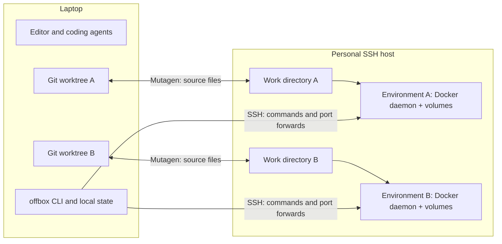

# offbox

Keep your editor and coding agents local. Give every git worktree its own full Docker stack on one cloud VM. Your compose files don't change.

Offbox syncs each worktree to its own privileged container, with a separate Docker daemon, volumes and port forwards. Run tests and builds remotely while keeping your editor, agents and Git history on the laptop.

## Quickstart

PyPI publishing is currently deferred. Install from this repository with [uv](https://docs.astral.sh/uv/getting-started/installation/):

```sh
uv tool install git+https://github.com/Avdeev99/offbox
offbox setup
cd your-repo
offbox up
offbox exec -- pytest
offbox ports
```

`setup` checks tools and offers a new Hetzner/Google Cloud host or an existing SSH server. Creating a cloud host requires your own account and credentials. Review its size and current price before approving creation. Existing-host initialization needs Ubuntu 24.04, passwordless sudo and UID 1000 available; see [providers](docs/providers.md).

When finished with a worktree, use `offbox rm --yes`. To delete a cloud host and stop its server charges:

```sh
offbox host list
offbox host destroy main --yes
```

`offbox stop` retains the environment's data. It does not delete the server or stop cloud billing. Hetzner bills servers until deletion, including powered-off servers. See [current pricing](https://www.hetzner.com/cloud/) and [billing rules](https://docs.hetzner.com/cloud/billing/faq/).

## How it works



Both worktrees can publish remote port 8000 and use the same Compose container names. Offbox gives them separate Docker daemons and local forwards such as `localhost:8000` and `localhost:8001`. `offbox ports --swap 8000` exchanges the preferred local port when an app needs a fixed callback URL.

`up` creates or starts the environment, synchronizes files, installs declared dependencies, starts the declared stack and restores forwards. `exec` flushes sync, checks dependency hashes and streams the requested command with its actual exit code. Git metadata is excluded from sync; run Git locally.

Use `offbox --timings up` or `offbox --timings exec -- COMMAND` to see stage durations on stderr. Timing totals exclude Python/CLI startup; command output and exit codes are preserved.

## Requirements and scope

- macOS or Linux client, Python 3.12+, Git 2.30+, OpenSSH 8+ and Mutagen 0.18.x. Windows clients use WSL2.
- An Ubuntu 24.04 amd64 host. The universal image is Linux amd64; an Apple Silicon laptop is supported as a client.
- OpenTofu 1.8+ or Terraform 1.6+ for cloud provisioning. If neither is installed, Offbox can download verified pinned OpenTofu. Mutagen must be installed separately.
- Trusted personal projects. Environment containers are privileged and share the host kernel; they are not a sandbox for untrusted code.

Supported built-in providers are Hetzner, Google Cloud and existing SSH hosts. Other cloud providers and arm64 images are outside the current scope. Cloud provisioning uses OpenTofu or Terraform. See [limits](docs/limits.md) and [security](docs/security.md).

## Configuration and examples

An `offbox.toml` at the Git worktree root configures resources, dependency installation, stack commands, forwards, sync ignores and allowed environment variables. Every key is optional. User host presets live under the XDG configuration directory. See the [complete configuration reference](docs/configuration.md).

- [FastAPI + Postgres](examples/python-compose/): real database-backed API and tests, with ports 8000 and 5432.
- [Vite + Playwright](examples/node-playwright/): a small web app and browser test, with port 3000.
- [Agent instructions and JSON contracts](docs/agents.md).
- [Architecture and lifecycle](docs/architecture.md).
- [Providers](docs/providers.md), [writing a provider](docs/writing-a-provider.md), and [troubleshooting](docs/troubleshooting.md).

## Related tools

| Tool | Main workflow |
| --- | --- |
| Offbox | Local Git/editor workflow with a separate Docker daemon per worktree on one personal host. |
| [DevPod](https://devpod.sh/docs/what-is-devpod) | Developer workspaces described by `devcontainer.json`, with local, SSH and cloud providers. |
| [Coder](https://coder.com/docs/admin/templates/managing-templates) | Developer workspaces created from Terraform templates. |
| [Agent sandbox APIs, such as E2B](https://docs.e2b.dev/) | Isolated execution environments created and controlled through SDKs/APIs. |

See [repository safeguards and fork contributions](docs/repository-safety.md) and [private vulnerability reporting](SECURITY.md).

## Development and validation

```sh
uv sync --frozen
make check
make test
uv build
```

CI runs strict lint/type checks, a Linux/macOS × Python 3.12/3.13 unit matrix and native amd64 image builds. The focused Linux Docker smoke job exercises real SSH, Mutagen, execution and forwarding with disposable local containers. It uses no cloud credentials or billable cloud resources. Cloud API provisioning and VM bootstrap remain unverified by that job; browser, OOM and performance tests are outside its scope.

Separately approved [Hetzner](docs/benchmarks/2026-10-23-hetzner.md) and [Google Cloud](docs/benchmarks/2026-10-23-gcp.md) benchmarks exercised provisioning and both sample apps, including browser tests, then verified cloud cleanup. The Google Cloud run also compares command batching on the same VM. Measurements and comparison limits are recorded in the reports.

Release workflows are prepared, but PyPI publishing and release tags are deferred. The public universal image follows the compatibility series defined by `DEFAULT_IMAGE` in [the package](src/offbox/__init__.py). See [CONTRIBUTING.md](CONTRIBUTING.md) for development, image and future publishing instructions. Licensed under [MIT](LICENSE).
