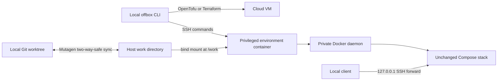

# Architecture

Offbox keeps Git, editors and coding agents on a single user's laptop. It moves commands and Docker workloads to a personal SSH host. The Python CLI coordinates existing command-line tools; it does not run a server or use a cloud SDK.

## Hosts and providers

A host is an Ubuntu 24.04 amd64 machine reachable with key-only SSH. The `hetzner` and `gcp` providers create a VM using OpenTofu or Terraform, render cloud-init and wait for the ready marker. The `ssh` provider initializes an existing server with passwordless sudo. Initialization installs Docker, creates the `offbox` account when UID 1000 is available, prepares `/srv/offbox`, and pulls the default environment image. Existing accounts and SSH/firewall policy are preserved during existing-host initialization.

Provider definitions are folders with a typed manifest and, for the `tofu` driver, Terraform files. Creation saves a copy of that folder, its hash, provider variables and provisional host state before applying. Destruction uses the saved workspace. A failed operation retains enough local information to retry cleanup. See [the provider contract](writing-a-provider.md).

## Per-worktree environments

Each worktree gets a stable name consisting of its directory slug and a hash of its canonical path. A host contains one privileged environment container, named Docker-data volume and synchronized work directory for each environment. Ownership labels must match local state before Offbox changes resources.

The universal image runs an independent Docker daemon with cgroup v2 and overlay2. Consequently two worktrees can use identical Compose project/container names, volume names and published ports. CPU/memory limits cover the entire environment, including its inner containers. See [the image contracts](universal-image.md) and [isolation limits](security.md).

`up` validates resources, prepares synchronization, creates or starts the container, waits for readiness, flushes source, runs declared setup and restores forwards. `up --fresh` replaces the container and its Docker data while preserving source. `stop` retains source/data and pauses sync. `rm` removes owned source/data and its local records. Garbage collection uses labels and worktree-path ownership checks rather than deleting arbitrary Docker resources.

## Synchronization and execution

Mutagen owns one validated session per environment. Synchronization is two-way-safe so generated source files can return to the laptop; conflicts require user resolution. Dependency/cache directories are ignored. Mandatory `.git` exclusion is the final pattern, so even linked-worktree pointer files cannot be re-included. Session mutations target immutable identifiers, and global Mutagen defaults do not change this contract.

`exec` flushes sync unless explicitly disabled, checks the declared dependency-file hash under a per-environment client lock, and runs through SSH and `offbox-run`. Arguments remain an argv list; declared install/stack strings are explicitly shell commands. Non-TTY stdin is closed unless requested. Output streams stay live and Offbox's own diagnostics use stderr.

The dependency hash and existing install marker are read in one SSH probe under that installation lock; post-install rehash and atomic marker writes remain separate. Automatic forwarding reads a fresh container/Compose snapshot in one probe, validates the expected running container's ownership before querying Compose, and validates the response locally before changing mappings. These probes reduce round trips without caching ownership, hashes, IP addresses or discovered ports across commands.

The execution shim records command identity, process-group metadata and final status outside `/work`. This allows Offbox to distinguish a remote exit 255 from an SSH failure and to relay SIGINT/SIGTERM to the remote process group with a bounded cleanup deadline. TTY execution uses terminal signal handling. See [agent contracts](agents.md).

## Forwarding, state and diagnostics

SSH ControlMasters carry loopback-only TCP forwards. Offbox discovers explicit and Compose-published ports, reserves local mappings across all hosts and replays exact forwards when reconciling state. It records the master PID and target container IP to detect replacement and remove old forwards accurately. `ports --swap` updates both affected environments, with rollback and an explicit recovery instruction when cleanup cannot be confirmed.

Typed local state is atomically replaced under a short file lock. Host/port/install operation locks coordinate longer work without holding the global state lock during network commands. XDG directories contain state, logs, provider workspaces and cached tools; short private `/tmp` paths hold SSH control sockets. Keep state until hosts are destroyed: it includes the information needed to clean up cloud resources.

`status --json` aggregates host, disk, environment, image, sync, port and stack checks into the documented `StatusReport`. A problem includes a corrective `Fix:`. Logs record scoped command context with known secret values redacted. Project stdout/stderr are passed through unchanged and can themselves contain secrets.

The [focused Docker smoke job](../tests/smoke/) exercises the real runtime components with local fixture containers. It seeds an SSH host record and therefore does not validate cloud provisioning or VM bootstrap. See [validation boundaries](limits.md#validation-boundaries).
